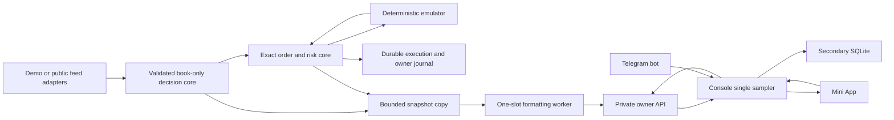

# Execution, durability and secondary observation

The deterministic core uses bounded maps, immutable IDs, exact cash and shares, and explicit transitions. Rust's type/runtime choices alone do not establish an execution latency target. The public feed core and emulator order core have distinct responsibilities: the former validates freshness and proposes quotes; the latter tracks accepted orders, commitments, partial fills and transport outcomes.

One actor admits owner operations and simulation transactions. A complete candidate transaction is evaluated first, durably appended with a hash chain, then adopted. Owner command identity and associated cancels/limits are one durable record, so a lost HTTP response can be reconciled using the same command. Recovery rejects damaged/partial records and replays accepted inputs before quoting. It starts paused, settles cancellations and preserves the kill latch and known simulated account state.

Disk durability is a primary execution dependency. Statistics, historical reporting, Telegram calls and UI delivery are secondary. The exact execution journal cannot be discarded on a full queue; a persistence fault stops new work. Secondary observations can be coalesced or dropped and expose that fact. No console failure changes engine risk limits or replenishes the simulated budget.

Periodic full-state JSON formatting and percentile sorting run in a background worker, with at most one outstanding task. Snapshot copy on the actor remains bounded and measured. Immediate owner/fault/source transitions may publish current state synchronously for precise acknowledgement. The private HTTP API consumes watch snapshots, rather than requesting work from the actor for every reader. CPU contention and bounded copying still have nonzero cost; selected-host tests must quantify their tails.

The console samples once per approximately one second, maintains a cached state envelope, and serves browser readers from that cache. It holds its own bounded SQLite history, sessions, logs and ingress queues. Docker gives it a separate persistent volume, 0.25 CPU and 128 MiB limit. The engine has 1 CPU and 512 MiB by default. These are local starting limits, not host sizing evidence. The engine token stays between console and engine; owner sessions and Telegram signatures authenticate frontend commands.

The filesystem fence applies only to processes sharing the same local state directory. The repository does not implement cross-host lease/fencing or active/active execution. Its active simulation contract is one market's Up/Down buy orders. Real SDK gateway, funded account reconciliation, fees, sells, settlement and multi-market inventory remain explicit later work.
