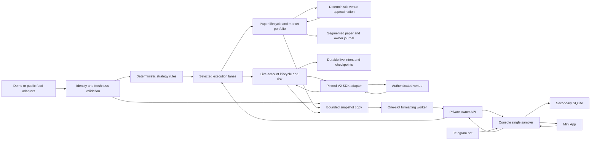

# Execution, durability and secondary observation

## Domains and startup

`mm2-core`, `mm2-strategy` and `mm2-portfolio` are deterministic libraries. They consume caller-supplied time, immutable market/order identity, exact prices and execution evidence. They have no network, wall-clock, persistence, dashboard or Telegram dependency. The strategy produces bounded desired slots; it does not release reservations or claim queue priority. Portfolio receipts model financial lifecycle, not blockchain dispatch.

The engine's public-book core verifies both outcome identities, freshness, timestamps and stream state. The actor applies the selected rules and owns paper recovery/control state. `simulation` executes locally from public observations; `shadow` proposes without simulated orders; `emulator` uses demo observations. `trading` attaches one live-account actor. `both` also attaches an independent paper actor fed through bounded channels. Both lanes retain separate capital, state and journals; a paper fill never becomes an authenticated account fill.

Every profile starts paused. The persisted execution profile binds mode/feed source and configured account-ledger location to its state directory. Live account identity binds the signer/funder, signature type, network/protocol and deployment contract tuple; validated risk/capacity policy can change without replacing that identity. Funded profiles require an explicit shared `live_state_dir`; packaged trading/both use `/data/account-live`. Switching those profiles preserves the account journal, spend/loss history and one local account fence. Startup selection cannot reinterpret an existing ledger or replenish cash. A direct unconfigured Compose start defaults to demo; the startup wrapper defaults to public simulation. Live templates contain no configured account or activation permission.

## Primary persistence and recovery

A paper transaction is evaluated against a candidate session, durably appended, then adopted. Owner CAS identity/receipt and associated paper cancels/limits share one durable record, so a lost HTTP response can reuse the same request. The command/execution chain spans sealed archives and the active segment. A synced seal records rotation intent before rename; recovery completes the last matching interrupted rotation or refuses damaged/missing evidence. Execution replay reads bounded records instead of building an unbounded tape in RAM.

`MultiMarketPaper` wraps the current deterministic session and a finite, market-keyed portfolio. Rollover drains/cancels old simulated orders before opening another market. Old unpaired positions stay attached to their original identity. Pair merge and demo resolution use explicitly synthetic accounting receipts; public-paper unresolved positions receive no invented winning outcome or valuation. Recovery validates current-session totals against retained portfolio totals and preserves cash, reservations and IDs.

The live actor serializes account effects through its shared account ledger and fence, independently of the mode-specific owner/paper directories. A signed wire intent and its possible-fill commitment are synced before authenticated posting. Post/cancel responses with unknown outcomes keep reservations. User-stream events trigger authoritative account/order queries rather than directly releasing funds. Restart never resends an old signed post blindly: it restores identities/uncertainty, stays paused, cancels/reconciles known orders and requires fresh account/stream/heartbeat state before Resume.

Owner control identity is forwarded consistently across selected lanes. Each lane has its own durable acknowledgement; there is no distributed atomic transaction across the owner, paper and live journals. Unknown acknowledgement requires the same request identity. Bounded delivery/recovery faults must remain visible rather than inventing success.

Disk durability is a primary execution dependency. All journals, owner receipt collections, market identities, operations and event queues have finite quotas. Rotation retains evidence and increases usable active-file longevity; it does not compact/delete old identity or permit infinite runtime. Capacity or persistence failure stops new work with commitments intact. Offline backup/restore fences the parent, companion paper and live state; restore uses a new destination and preserves originals. See [OPERATIONS.md](OPERATIONS.md).

## Limited technical trading adapter

`mm2-live` pins SDK V2 0.7.0, Polygon deployment, token-order schema, supported signature/funder derivation and market allowlist. It checks authenticated market/token/tick/minimum/fee data, signs BUY-only post-only orders, schedules cancels separately from new prepares/posts, sends heartbeat and reconciles orders/positions/collateral. Quote freshness and network operations have bounded deadlines. The live risk actor admits against collateral/allowance, retained commitments, gross cost, one-sided possible fills, allowed markets and configured worst-loss budgets.

The implemented SDK path is validated in controlled mocks. Signature types 0/1/2 use the EOA/canonical proxy/one-owner Safe path. Signature type 3 uses the pinned native-beacon DepositWallet and canonical SDK ERC7739/TypedDataSign order wrapper, while CLOB L2 authentication uses its controlling EOA. Read-only chain preflight pins factory, the beacon's effective implementation for this wallet, owner, domain and approvals. V3 position protocol, negative-risk markets and sells remain unsupported. Public wallet/contract inspection supplies identity evidence; it does not establish private-key/API acceptance, funded execution or profitability.

A separate Polygon worker closes standard positions. Direct accounts persist signed raw EIP1559 transactions and bounded owner-paid POL costs. DepositWallet stores an owner-signed EIP712 Batch and exact relayer envelope, syncs its dispatch marker, then sends one POST. Acknowledgement ID and discovered chain hash are additional durable evidence: the batch digest is the intent identity, not an explorer transaction hash. Bounded wallet log scanning recovers a lost acknowledgement and binds the complete factory batch/signature plus wallet Execution/BatchExecuted events before the common finalized token/collateral verifier credits owned returns. Gas sponsorship is recorded separately from the owner's gas budget.

Expired DepositWallet authorization is a distinct outcome: a canonical finalized block past the signed deadline, unchanged nonce and condition token prestate permits clearing only that expired reservation, with no payout/receipt and a fault requiring owner investigation/Reset. Pause/restart query existing evidence without repeating relayer POSTs. A nonce advance, provider absence, API terminal label or changed token balance alone never clears uncertainty. External AutoRedeemer approvals can mutate positions without wallet nonce progression, so the sole-writer gate rejects both pinned operators until the owner disables approvals or an independently reviewed external-receipt accounting path exists. Current code does not import such receipts or revoke approvals.

## Secondary observation

Periodic state formatting and percentile sorting run in a background worker with at most one outstanding task. Bounded snapshot copy remains on the actor and is measured. Owner/fault/source transitions may publish immediately for acknowledgement precision. Private HTTP readers consume watch snapshots rather than requesting a fresh decision from the actor. Decision CPU timing, loopback API probe timing, durability and exchange post/cancel latency retain separate scopes. None is a zero-overhead claim.

The console samples approximately once per second and serves browser readers from its cached envelope. It owns bounded SQLite history, sessions, logs and ingress. Docker separates its persistent volume, CPU and memory from the engine. The engine token stays between console and engine; owner sessions and signed Telegram initData authenticate frontend commands. Engine risk/identity/accounting must continue independently of console, SQLite and Telegram.

Filesystem fences apply to one local lock/filesystem domain. Cross-host leases, active/active account execution and HA failover are outside this package. Container resource limits are local starting bounds; selected-host soak, alerts, HTTPS and latency measurements establish deployment suitability separately.
